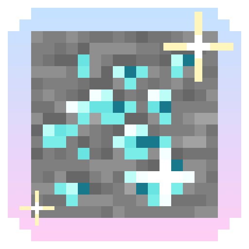
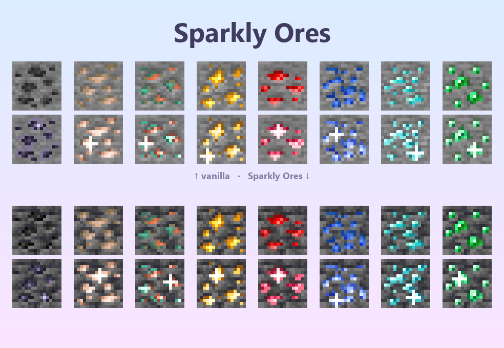
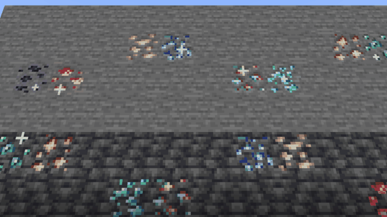

<p align="center"></p>

# Sparkly Ores

Un paquete de texturas para Minecraft que les da a los minerales colores pastel más vivos y destellos animados que brillan por turnos. Funciona sin mods.





## Qué hace
- **Colores pastel en cada mineral**: hierro durazno, redstone rosada, carbón lila, oro suave, lapislázuli celeste, diamante aguamarina, esmeralda menta y cobre de dos tonos. En piedra, pizarra profunda y el Nether.
- **Destellos animados** con archivos `.mcmeta`, sin mods.
- **Escombros ancestrales** con sus propios destellos.
- **Brillo en la oscuridad** opcional con OptiFine o Continuity (texturas `_e`).

## Instalación
1. Descarga el zip de tu versión desde [Releases](https://github.com/ccrccne/sparkly-ores/releases). El nombre termina en `+26.3`, `+1.21.1` o `+1.20.1`.
2. En Minecraft ve a **Opciones → Paquetes de recursos → Abrir carpeta de paquetes** y pon el zip ahí, sin descomprimir.
3. Pásalo a la columna de la derecha y pulsa **Listo**.

Funciona en **Minecraft 26.3**, **1.21 / 1.21.1** y **1.20 / 1.20.1** (Java), con Forge, NeoForge, Fabric u OptiFine.

## Cómo se hace
- [`build.py`](build.py): lee las texturas originales del juego (de la caché de Fabric Loom), detecta los píxeles del mineral, los pinta con una rampa pastel y arma la animación de destellos.
- [`preview.py`](preview.py): genera la comparación y el GIF.

```bash
python build.py
python preview.py
```

## Licencia
Los scripts son [MIT](LICENSE). Las texturas son recoloreos de las originales de Minecraft, propiedad de Mojang. No es un producto oficial de Minecraft; no está aprobado ni asociado con Mojang o Microsoft.

Hecho por **ccrccne** · [ccrccne.github.io](https://ccrccne.github.io) · [Ko-fi](https://ko-fi.com/ccrccne)
